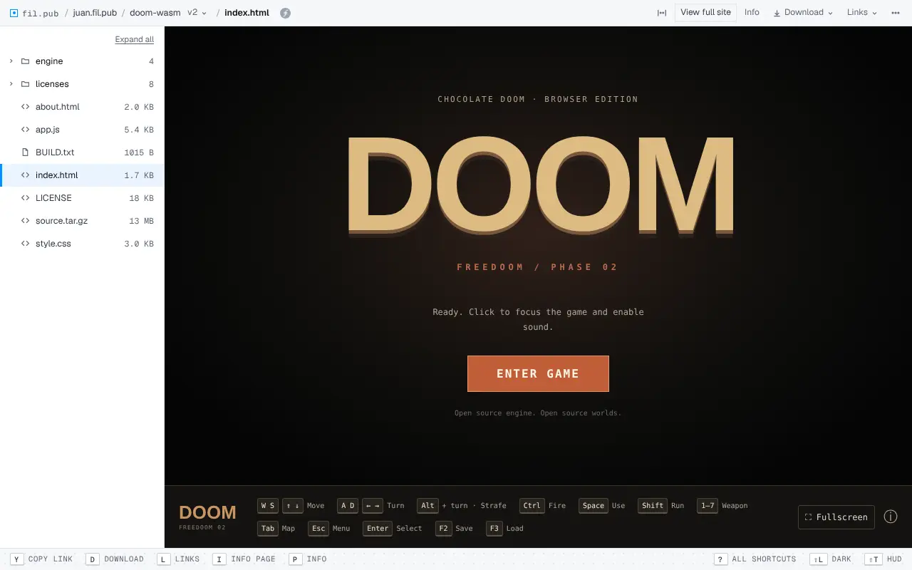
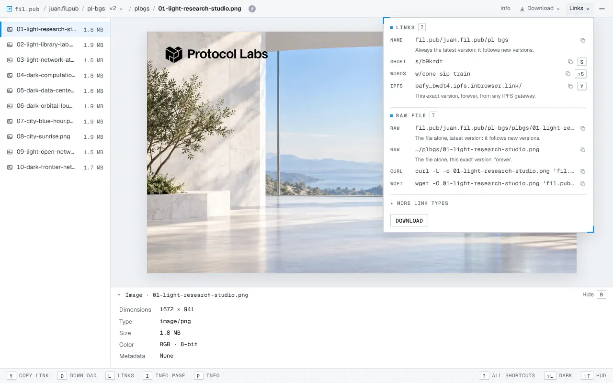
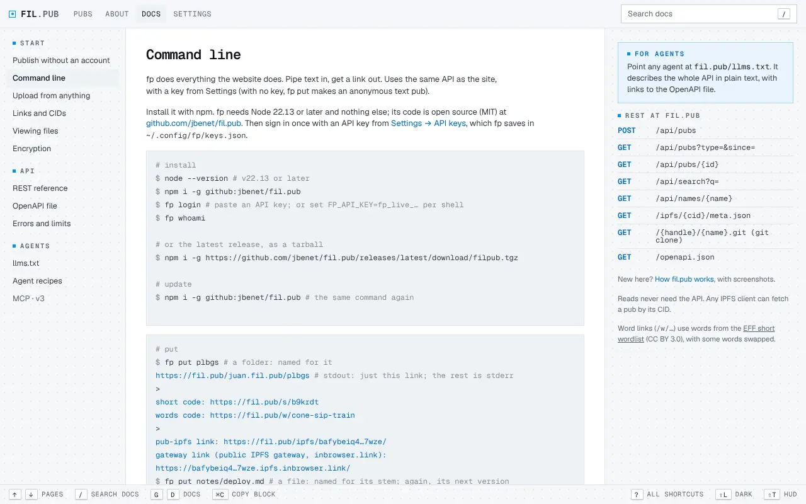
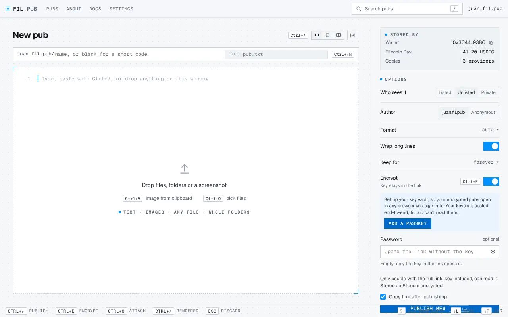
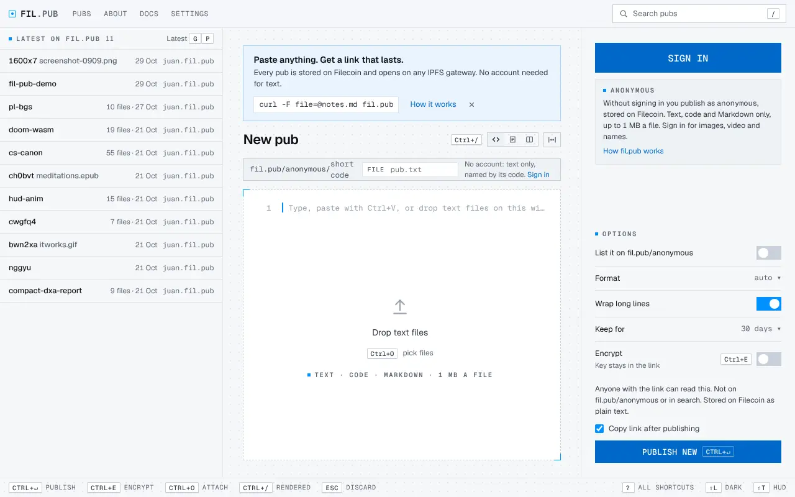
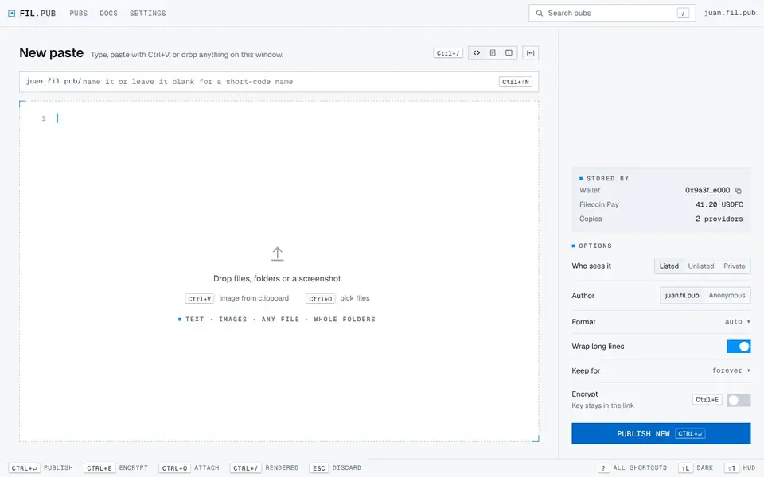

# What's new on fil.pub

New features and notable fixes on [fil.pub](https://fil.pub) and in `fp`, newest first, one section a week.
Small fixes are summed up in one line. Security fixes are listed without their details.

## Week of Oct 26, 2026

- **`fp` is open source.** The command line lives at [github.com/jbenet/fil.pub](https://github.com/jbenet/fil.pub) (MIT). Install it with `npm i -g github:jbenet/fil.pub` or from the latest release; Docs → Command line shows how.
- **Sites can run WebAssembly.** Folder pubs that ship `.wasm` (games, small tools) now run, and their scripts can read files in ranges. Pubs stay sandboxed.
- **Folder sites on IPFS gateways.** Opened through a subdomain gateway like `<cid>.ipfs.inbrowser.link`, a folder pub runs as a website on its own origin, with workers and WebAssembly. Encrypted folder sites can start workers and read files in ranges.
- **Raw file links.** The Links menu adds the file alone (latest or this exact version) and ready-to-paste `curl` and `wget` lines. `?raw` on a name link serves the file. Menus in the bar open on hover.
- **Link previews with images.** A pub shared in a chat gets a 1200×630 card, and a folder of images shows its images.
- **The key vault stays open** in every tab while you're signed in; signing out locks it.
- **`fp put`** prints one main link on stdout and the labeled ones on stderr, names a pub after its file, takes flags to print only the links you want, and every command has its own `-h`.
- **This changelog**, in Docs → What's new and in the public repo.
- Fixes: a filename you type without an extension keeps none, and the file is typed by its contents. The HUD theme's background animation is bigger and fainter.

## Week of Oct 19, 2026

- **Publish without an account.** Text, code and Markdown under `anonymous`, from the New page, `fp put` or `curl -F file=@notes.md fil.pub`. Pubs expire after 30, 7 or 1 days, can be read once, and come with a delete token.
- **Accounts for everyone.** Sign up with a wallet, a passkey, email or Bluesky. Get a handle like `you.fil.pub`, or use your own domain (the same `_atproto` record as Bluesky). Profiles and search.
- **Pay for your own storage.** An account can keep its pubs in its own Filecoin data sets, paid from its own wallet. fil.pub never holds your money.
- **Private, Unlisted or Listed** for every pub. Unpublish, delete, and rename a pub after publishing; the pub's name and the filename are separate.
- **Folders and sites.** A folder pub runs its HTML as a website, with its README under it. HTML pubs run as their own page. Edit one file of a folder, or several at once.
- **Readers.** Markdown gets a contents list and Source and Split views. PDFs show as pages. EPUB books open in a reader with Chapter, Scroll and Pages views. Videos autoplay, and images fit and zoom.
- **Key vault.** The keys of your encrypted pubs sync with your account, end-to-end encrypted. Signing in opens it, and one passkey covers both.
- **Passwords** can go on top of the key of an encrypted pub.
- **Photo metadata** (location, camera) is stripped from images before they're published, with a per-publish opt-out.
- **Uploads up to 1 GB** for paying accounts, resumable from the New page.
- **A page that explains fil.pub** at [/about](https://fil.pub/about), and a public status page at [/status](https://fil.pub/status).
- **Report button** on every pub.
- **The HUD theme on every page**, and three rounds of phone fixes: bigger tap targets, no zoom on inputs, nothing scrolls sideways.
- **Faster pages**: a smaller first load, compressed assets, and git histories kept between visits.
- Fixes: dead links say Not found (404 or 410), `fp ls` lists every pub, the Pubs list pages past 200 names, and about 60 smaller fixes. Security: hardening from several reviews.

## Week of Oct 12, 2026: the first version

- **Pubs.** Paste text or drop files, images or folders and get a link. Every pub is an IPFS folder stored on Filecoin, three copies with different providers.
- **Links that last.** `/ipfs/<cid>/` works on any IPFS gateway; names live under your handle, with short links too.
- **Versions.** A named pub keeps every version in a small git repo you can `git clone`.
- **Encryption** in your browser, with the key in the link's `#` part, which never reaches the server. **Signed pubs** show who published them.
- **`fp`**, a REST API with an OpenAPI file, `llms.txt` for agents, and a ShareX config.
- **Two themes**, Sharp and HUD (⇧T), light and dark, and keyboard shortcuts everywhere (`?` lists them).

