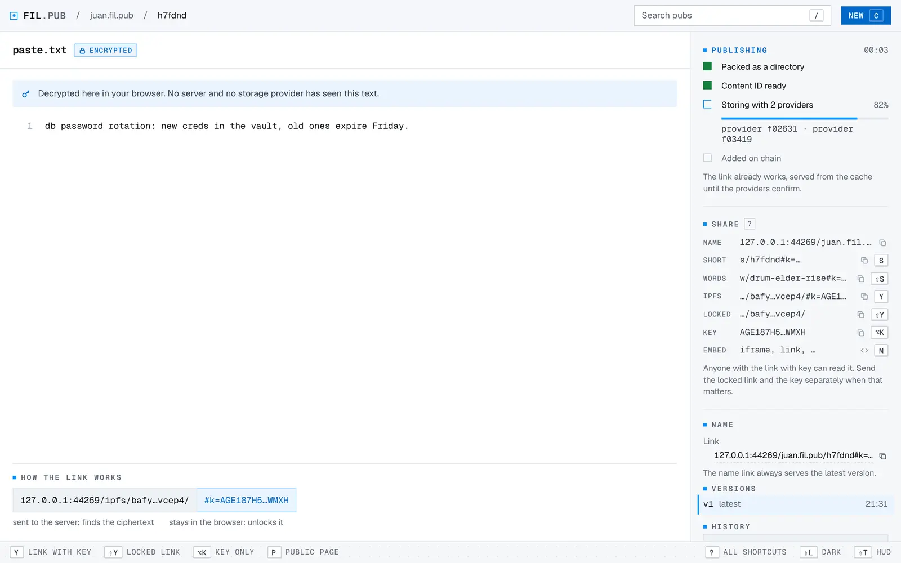
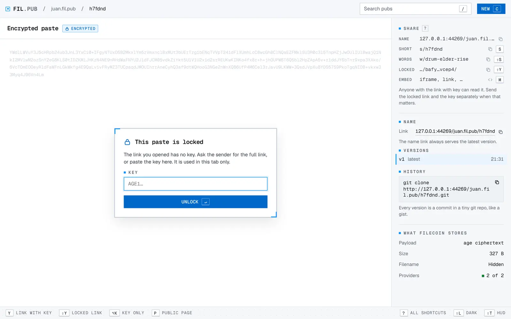

# fil.pub

**Paste once. Keep it on Filecoin.**

[fil.pub](https://fil.pub) is a pasteboard and image host where every pub is an IPFS directory
stored by Filecoin providers who prove, every day, that they still have it. Paste text, drop a
screenshot or a folder, and get a link that is the content's own address.

<picture>
  <source media="(prefers-color-scheme: dark)" srcset="images/publish-dark.webp">
  
</picture>

This repository holds fil.pub's public parts, starting with `fp`, the command line. It is
published from fil.pub's own repository by CI; see [CONTRIBUTING.md](CONTRIBUTING.md).

| What | Where |
| --- | --- |
| `fp`, the command line | [`cli/`](cli/), docs in [docs/cli.md](docs/cli.md) |
| The HTTP API | [docs/api.md](docs/api.md), [openapi.json](openapi.json) (OpenAPI 3.1) |
| A guide for agents | [llms.txt](llms.txt) |

## Install fp

`fp` needs Node 22.13 or later and has no dependencies.

```sh
npm i -g github:jbenet/fil.pub
fp login            # paste an API key from fil.pub → Settings → API keys
```

Run the same `npm i -g` again to update. Or install a release tarball:
`npm i -g https://github.com/jbenet/fil.pub/releases/latest/download/filpub.tgz`
(swap `latest/download` for `download/v<version>` to pin one).

## Use it

```sh
$ cat crash.log | fp put -
https://fil.pub/juan.fil.pub/x7k2qd
$ fp put notes.md --name notes --encrypt
https://fil.pub/ipfs/bafybeif2…m3xa/#k=AGE1…
$ fp put shot.png | pbcopy        # the link goes to stdout, everything else to stderr
```

No account? Anyone can publish text with plain curl:

```sh
echo 'hello' | curl -F 'file=@-;filename=hi.txt' https://fil.pub
```

Every command is in [docs/cli.md](docs/cli.md), or run `fp help`.

## Why

Pastebins and image hosts come and go, and every link they ever handed out goes with them.
Screenshots in old issues turn into broken boxes; logs in chat threads 404.

fil.pub keeps the bytes somewhere verifiable instead. A pub's link is its CID, so anyone can
check they got the right bytes, and any IPFS gateway can serve them. Storage is paid on
Filecoin, and the providers' proofs are on chain for anyone to see. fil.pub is just a nice way in.

## How it works

1. **Paste.** Type, paste or drop anything: text, code, images, PDFs, books, whole folders. Turn
   on encryption and your browser (or `fp --encrypt`) seals it with [age](https://age-encryption.org)
   before anything leaves your machine.
2. **Pack.** fil.pub packs it as an IPFS directory: your file under its real name, a `meta.json`
   and a tiny loader page. The directory's CID is the link.
3. **Store.** The bytes go to three storage providers through Filecoin Onchain Cloud. Each
   provider proves every day that it still holds them (PDP), and Filecoin Pay streams their USDFC.
4. **Share.** The link works the moment you publish. After that any IPFS gateway or client can
   fetch it by CID, with or without fil.pub.

## What it does

- **Every file shows as itself.** Markdown renders, code is highlighted, images show their EXIF,
  EPUBs open as books and PDFs page by page. A folder with an `index.html` runs as a site.
- **The key lives in the link.** Encrypted pubs are sealed on your machine. The key rides in the
  link's `#k=…` fragment, which browsers never send to a server, so fil.pub and the providers
  only ever hold ciphertext.
- **Names with history.** Give a pub a name and `juan.fil.pub/notes` always serves its latest
  version. Every version is a commit in a tiny git repo: `git clone` it.
- **No account needed** for text: unlisted by default, deleted after 30 days, or read once and gone.
- **Handles are domains.** Accounts get `you.fil.pub`, or bring a domain you own (the same
  `_atproto` TXT record Bluesky uses). Pubs can be signed, so authorship travels with the CID.
- **Built for agents.** A REST API, an OpenAPI file, llms.txt, `fp` and ShareX presets. Upload
  keys can publish but never change anything.

<picture>
  <source media="(prefers-color-scheme: dark)" srcset="images/secret-dark.webp">
  
</picture>
<picture>
  <source media="(prefers-color-scheme: dark)" srcset="images/locked-dark.webp">
  
</picture>

More at [fil.pub/about](https://fil.pub/about) and [fil.pub/docs](https://fil.pub/docs).
Service status: [fil.pub/status](https://fil.pub/status).

## License

[MIT](LICENSE).
